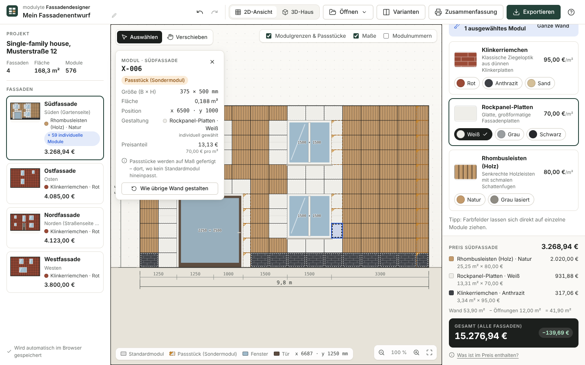
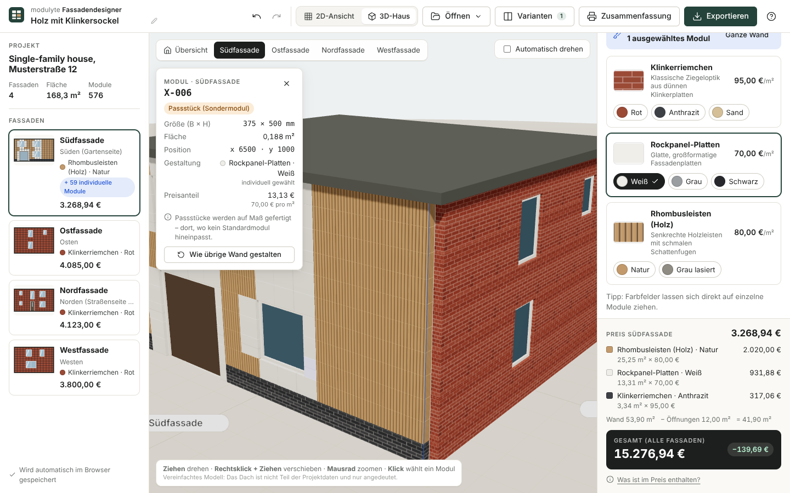
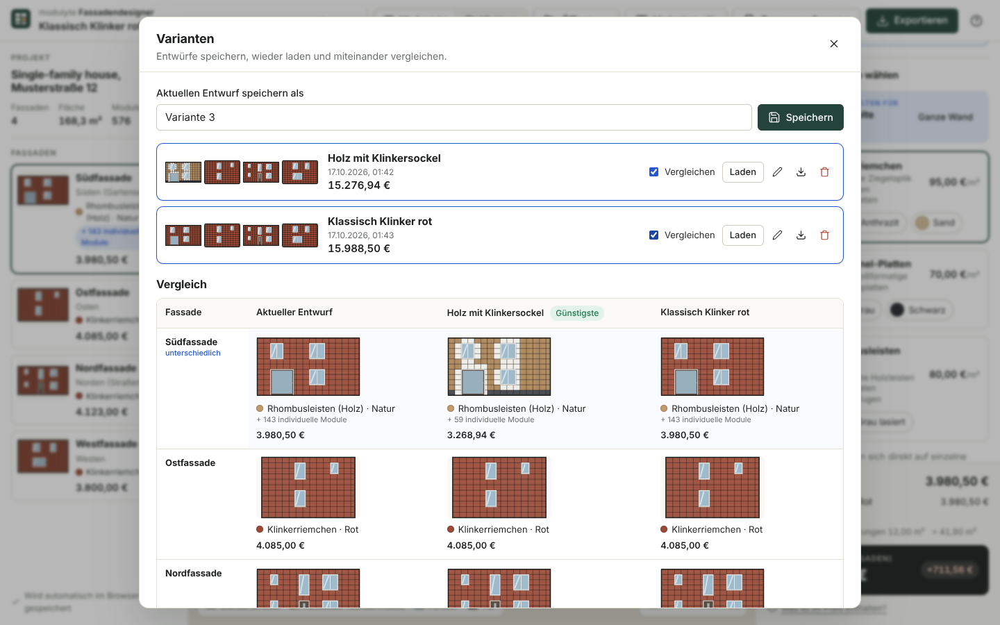
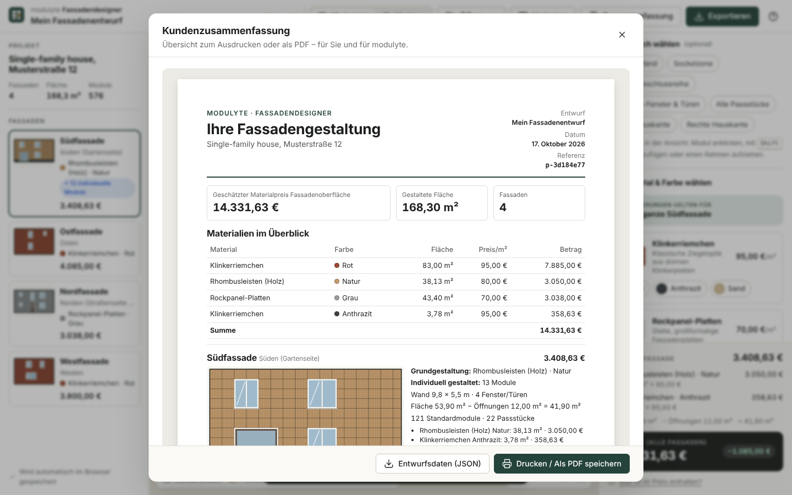

# Modulyte Facade Designer

Interactive facade configurator for **modulyte GmbH**. Homeowners open a building project supplied as JSON, style each facade with the available materials and colours (for a whole wall or for any group of modules), see the price update live, compare design variants in 2D and 3D, and hand the final design back to Modulyte as a printable summary and a versioned JSON export.

> Customer-facing UI language: **German** (MVP). Code, docs, identifiers and commits: **English**.



| 3D house                                  | Variant comparison                                 | Customer summary (print/PDF)                      |
| ----------------------------------------- | -------------------------------------------------- | ------------------------------------------------- |
|  |  |  |

Example print output: [`docs/screenshots/customer-summary-example.pdf`](docs/screenshots/customer-summary-example.pdf).

---

<details>
  <summary><h2>Quick start</h2></summary>

Requirements: Node.js **22.12+**.

```bash
npm install
npm run dev          # http://localhost:5173
```

The app opens the supplied example house (`static/projects/fassadendesigner_house.json`) automatically. Use **Öffnen → Datei öffnen …** (or drag a `.json` file onto the window) to load another project or a previously exported design.

| Command                 | Purpose                                                                                               |
| ----------------------- | ----------------------------------------------------------------------------------------------------- |
| `npm run dev`           | Development server with hot reload                                                                    |
| `npm run build`         | Static production build in `build/` (SPA, deployable to any static host)                              |
| `npm run preview`       | Serve the production build locally                                                                    |
| `npm run check`         | `svelte-check` with strict TypeScript, warnings fail                                                  |
| `npm run lint`          | Prettier check + ESLint (incl. Svelte rules)                                                          |
| `npm run format`        | Format all files with Prettier                                                                        |
| `npm run test:unit`     | Vitest unit/integration tests                                                                         |
| `npm run test:coverage` | Unit tests with V8 coverage report                                                                    |
| `npm run test:e2e`      | Playwright end-to-end tests (builds and serves the app; first run: `npx playwright install chromium`) |
| `npm run verify`        | check + lint + unit tests + build (what CI's first job runs)                                          |

</details>
